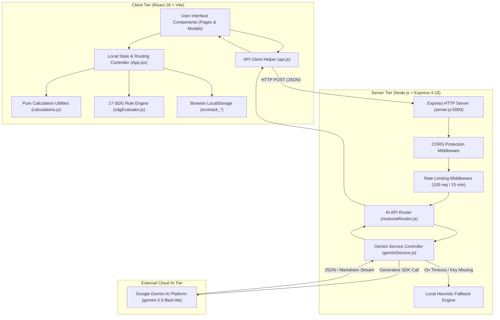
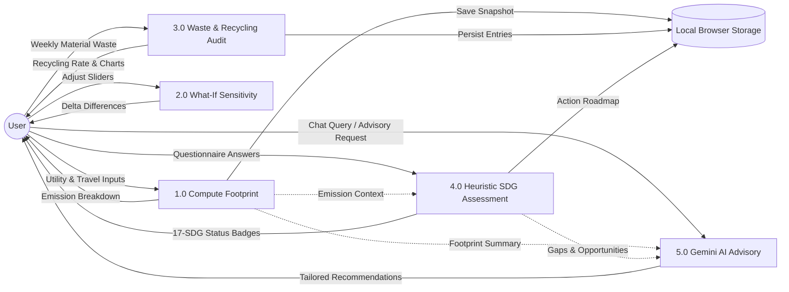
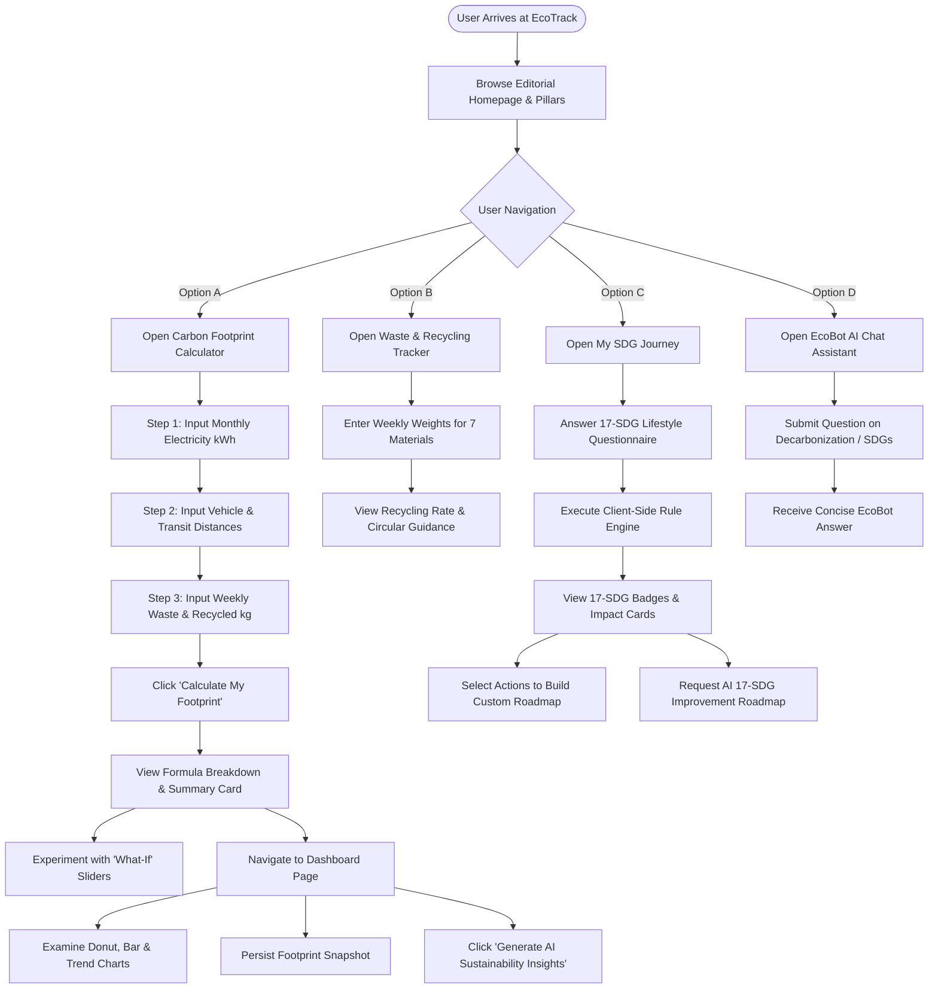
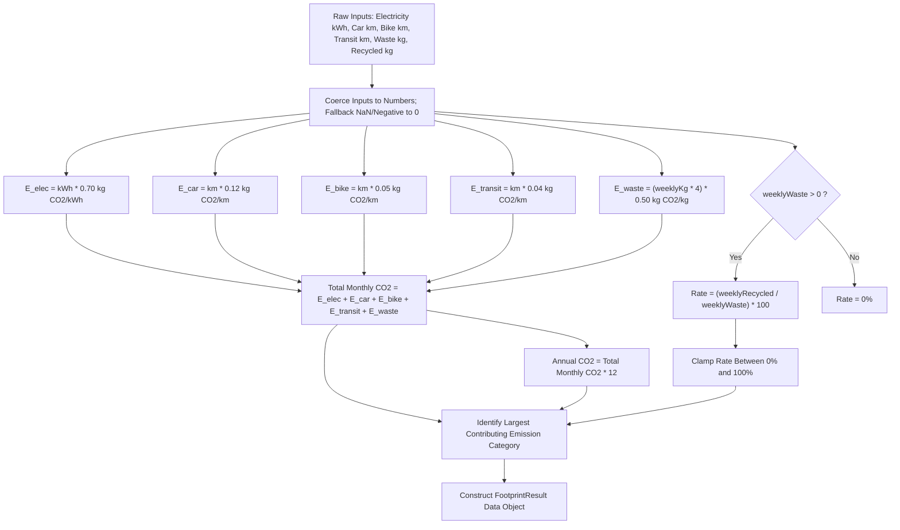
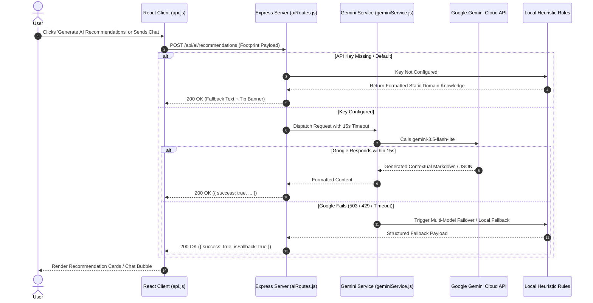

# EcoTrack: Complete Project Information and Technical Documentation

> **Academic Project Documentation for Engineering Project Report**  
> **Course / Subject:** Circular Economy for Sustainable Development  
> **Project Title:** EcoTrack – AI-Powered Carbon Footprint Calculator & SDG Impact Tracking System  
> **Domain:** Environmental Informatics, Sustainable Software Engineering, Applied Artificial Intelligence, Circular Resource Stewardship  
> **Date of Generation:** October 2026  

---

## Table of Contents
1. [Project Overview](#1-project-overview)
2. [Introduction and Problem Definition](#2-introduction-and-problem-definition)
3. [Literature Survey and Theoretical Framework](#3-literature-survey-and-theoretical-framework)
4. [Complete Technology Stack](#4-complete-technology-stack)
5. [System Architecture and Visual Models](#5-system-architecture-and-visual-models)
6. [Working Methodology and Procedural Algorithms](#6-working-methodology-and-procedural-algorithms)
7. [Mathematical Modeling and Carbon Accounting Formulas](#7-mathematical-modeling-and-carbon-accounting-formulas)
8. [Detailed Module-by-Module Technical Specifications](#8-detailed-module-by-module-technical-specifications)
9. [Software Implementation and Engineering Details](#9-software-implementation-and-engineering-details)
10. [Verification, Testing, and Validation Results](#10-verification-testing-and-validation-results)
11. [Results, Analytical Insights, and Discussion](#11-results-analytical-insights-and-discussion)
12. [Scope of Work, Limitations, and Future Roadmaps](#12-scope-of-work-limitations-and-future-roadmaps)
13. [Academic Conclusion Material](#13-conclusion-material)
14. [Verified Academic and Standards References](#14-references)
15. [Academic Report Structuring Guide](#15-academic-report-structuring-guide)
16. [Information Missing for Final College Report](#16-information-missing-for-final-college-report)

---

## 1. Project Overview

### 1.1 Project Title and Full Characterization
- **Title:** EcoTrack – AI-Powered Personal Carbon Footprint Calculator & Sustainable Development Goals (SDG) Assessment System
- **Nature of Project:** Full-stack progressive web platform combining quantitative emission accounting, circular solid waste auditing, multi-tiered rule-based heuristic lifestyle assessment, and generative conversational artificial intelligence.
- **Context:** Academic engineering capstone project designed for the curriculum subject **"Circular Economy for Sustainable Development"**.

### 1.2 Background and Motivation
Anthropogenic climate change driven by atmospheric accumulations of greenhouse gases (GHGs) represents one of the most critical challenges facing contemporary society. While international treaties (such as the Paris Agreement aiming to limit warming to 1.5°C above pre-industrial baselines) govern sovereign states, individual household consumption choices collectively account for over 60–70% of global greenhouse gas emissions when accounting for domestic power, personal transit, food systems, and consumer discard flows.

Despite widespread public awareness of global warming, an acute **"value-action gap"** persists: individuals frequently express concern regarding environmental deterioration but lack clear, quantitative insight into how specific daily routines translate into equivalent kilograms of carbon dioxide ($kg\text{ CO}_2e$). Furthermore, existing sustainability platforms present disjointed metrics—either focusing purely on emissions, or solely on recycling, or treating the United Nations Sustainable Development Goals (SDGs) as abstract geopolitical targets disconnected from personal lifestyle habits. 

EcoTrack was conceived to resolve this fragmentation by providing an integrated, interactive digital tool connecting personal resource consumption to emission figures, circular waste hierarchy principles (Reduce $\rightarrow$ Reuse $\rightarrow$ Repair $\rightarrow$ Recycle), and the UN 2030 Agenda.

### 1.3 Problem Statement
Individuals lack an accessible, transparent, and privacy-preserving computational tool that:
1. Translates mundane daily activities (kWh of grid electricity, vehicle kilometers, public transit usage, and weekly waste generation) into tangible greenhouse gas equivalents using transparent, verified educational factors.
2. Evaluates household solid waste management against the circular hierarchy of recovery rather than merely calculating disposal masses.
3. Systematically maps routine personal behaviors across **all 17 United Nations Sustainable Development Goals (SDGs)** rather than a generic or arbitrary subset.
4. Provides localized, low-friction lifestyle decarbonization guidance powered by conversational AI without locking user private data behind mandatory server databases or account credentials.

### 1.4 Primary Objectives
1. **Develop an Educational Carbon Footprint Engine:** Implement client-side deterministic algorithms computing monthly and annualized carbon footprints across five core activity streams: electricity, passenger cars, petrol two-wheelers, public transportation, and solid waste.
2. **Implement Interactive "What-If" Sensitivity Modeling:** Enable dynamic slider-based scenario analysis to demonstrate how marginal lifestyle modifications (e.g., shaving 50 kWh off electricity or shifting 100 km from private cars to buses) immediately impact net carbon emissions.
3. **Formulate a Dedicated Circular Waste & Resource Audit:** Create a 7-material classification matrix (plastic, paper/cardboard, organic, glass, metal, e-waste, mixed) calculating diversion and material recycling recovery rates.
4. **Build a 17-SDG Multi-Dimensional Evaluation System:** Create an interactive lifestyle assessment questionnaire evaluating user contributions, gaps, and personal action roadmaps across **all 17 UN Sustainable Development Goals**.
5. **Integrate an Intelligent Sustainability Assistant (EcoBot):** Integrate the Google Gemini Generative AI SDK with dual failover resilience (cloud AI streaming with a comprehensive rule-based local heuristics fallback engine).
6. **Ensure Zero-Data-Footprint Local Storage:** Persist historical evaluations, challenge checkmarks, and custom SDG action roadmaps entirely within browser `localStorage`, ensuring zero data harvesting and sub-second load times.

### 1.5 Target Users and Practical Applications
- **University and School Students:** Conducting coursework, academic projects, or environmental club activities on sustainability, climate action, and resource flows.
- **Urban Households and Families:** Tracking monthly utility bills, vehicle fuel consumption, and kitchen discards to establish an empirical family carbon reduction baseline.
- **Sustainability Educators & Course Facilitators:** Utilizing the platform in workshops to teach emission factor arithmetic, circular economy loops, and SDG localization.
- **Community Environmental Groups:** Running collective "Eco Challenges" and monitoring aggregate weekly habit adjustments.

---

## 2. Introduction and Problem Definition

### 2.1 Environmental Context of Personal Carbon Accounting
A carbon footprint represents the total greenhouse gas emissions caused directly and indirectly by an individual, organization, event, or product, expressed as carbon dioxide equivalent ($CO_2e$). Carbon dioxide equivalent standardizes diverse greenhouse gases—including methane ($CH_4$), nitrous oxide ($N_2O$), and fluorinated hydrofluorocarbons—according to their respective 100-year Global Warming Potentials (GWP).

Under the IPCC Fifth and Sixth Assessment Reports (AR5/AR6), the global average per capita carbon footprint stands at approximately $4.7\text{ tonnes }CO_2e/\text{year}$, with industrialized urban centers often exceeding $10\text{ to }15\text{ tonnes}$. To keep global temperatures within the $1.5^\circ C$ threshold of the Paris Agreement, the Intergovernmental Panel on Climate Change (IPCC) indicates that average individual per capita footprints must converge toward approximately $2.0\text{ to }2.5\text{ tonnes }CO_2e/\text{year}$ by 2030.

### 2.2 Shortcomings of Conventional Carbon Calculators
A critical review of existing online carbon calculators highlights several operational deficiencies:
- **Black-Box Arithmetic:** Many commercial tools hide calculations behind complex multi-variable models, leaving users unable to trace how their inputs yielded a specific result.
- **Data Harvesting & Paywalls:** Users are frequently required to create accounts, enter email addresses, or provide sensitive location information before viewing output metrics.
- **Linear Waste Accounting:** Waste is frequently treated as an unavoidable aggregate mass sent to landfill, ignoring material segregation, composting, circular reuse, and repair.
- **Superficial SDG Tagging:** Most platforms merely mention "SDG 13 (Climate Action)" as a decorative marketing tag rather than evaluating how daily choices relate to systemic goals like SDG 6 (Clean Water), SDG 7 (Clean Energy), SDG 11 (Sustainable Cities), or SDG 12 (Responsible Consumption).
- **Absence of Actionable Interactive Scenarios:** Static result displays tell users that their footprint is high without providing interactive tools to explore "What If" changes.

### 2.3 EcoTrack's Solution Paradigm
EcoTrack bridges these deficiencies through transparency, privacy, and pedagogical design:
1. **Transparent Mathematical Formulation:** Every formula, emission factor, and multiplication step is exposed in an interactive "Emission Breakdown Table".
2. **Local-First Privacy Architecture:** No database, authentication token, or server-side user profiling is used. All personal activity data is retained exclusively on the client machine via browser storage APIs.
3. **Circular Economy Integration:** Differentiates material recycling from biological composting and promotes the circular ladder: **Reduce $\rightarrow$ Reuse $\rightarrow$ Repair $\rightarrow$ Recycle**.
4. **Complete 17-SDG Coverage:** Evaluates all 17 Sustainable Development Goals through dedicated questionnaires, visual status badges ("Supporting", "Developing", "Opportunity to Improve"), and customized 3-tier action plans.

---

## 3. Literature Survey and Theoretical Framework

### 3.1 Greenhouse Gas Protocol (GHG Protocol) Standards
The World Resources Institute (WRI) and the World Business Council for Sustainable Development (WBCSD) established the **GHG Protocol Corporate and Value Chain Standards**, which categorize emissions into three operational scopes:
- **Scope 1 (Direct Emissions):** Fuel burned in personal motorcars and two-wheelers.
- **Scope 2 (Indirect Emissions from Purchased Energy):** Grid electricity consumed for residential lighting, space cooling/heating, and home electronics.
- **Scope 3 (Other Indirect Value Chain Emissions):** Upstream and downstream municipal solid waste decomposition and transit manufacturing lifecycle.

EcoTrack incorporates educational proxies reflecting Scopes 1, 2, and 3:
- Domestic purchased electricity maps to Scope 2.
- Personal petrol transport (cars, two-wheelers) maps to Scope 1.
- Public bus/transit and municipal solid waste decomposition map to Scope 3.

### 3.2 IPCC Emission Factor Methodology
According to the IPCC Guidelines for National Greenhouse Gas Inventories:
$$\text{Emissions } (E) = \text{Activity Data } (A) \times \text{Emission Factor } (EF)$$

Where:
- $\text{Activity Data } (A)$ represents the quantified measure of human activity (e.g., $kWh$ consumed, $km$ driven, or $kg$ discarded).
- $\text{Emission Factor } (EF)$ represents the coefficient converting unit activity into mass of greenhouse gas ($kg\text{ }CO_2e/\text{unit}$).

EcoTrack adopts standard educational averages representing global/developing-grid urban averages:
- **Grid Electricity:** $0.70\text{ kg }CO_2e/kWh$ (representative of mixed fossil/hydropower regional grids).
- **Passenger Car:** $0.12\text{ kg }CO_2e/km$ (representative of compact-to-midsize internal combustion petrol/diesel vehicles).
- **Two-Wheeler (Motorbike/Scooter):** $0.05\text{ kg }CO_2e/km$ (representative of 100–150cc four-stroke petrol commuter bikes).
- **Public Transit:** $0.04\text{ kg }CO_2e/\text{passenger-km}$ (representative of commuter bus systems operating at normal occupancy).
- **Solid Waste:** $0.50\text{ kg }CO_2e/kg\text{ waste/month}$ (simplified empirical approximation of anaerobic landfill decay releasing methane gas).

### 3.3 Circular Economy Framework
The circular economy model formulated by the Ellen MacArthur Foundation and adopted by the European Union and NITI Aayog transitions away from the linear industrial paradigm:
$$\text{Linear Economy: Take } \longrightarrow \text{ Make } \longrightarrow \text{ Use } \longrightarrow \text{ Dispose}$$
$$\text{Circular Economy: Reduce } \longrightarrow \text{ Reuse } \longrightarrow \text{ Repair } \longrightarrow \text{ Remanufacture } \longrightarrow \text{ Recycle}$$

EcoTrack operationalizes this paradigm through:
1. **Material Segregation:** Tracking wet organic food waste distinctly from dry technical nutrients (plastic, paper, glass, metal).
2. **Biological Recovery vs. Material Recycling:** Emphasizing that composting food waste constitutes biological nutrient recovery, whereas mechanical remelting of glass/aluminum constitutes technical loop recycling.
3. **Behavioral Eco Challenges:** Daily prompts dedicated to refusing single-use plastics, using reusable containers, repairing electrical appliances, and using both sides of paper.

### 3.4 United Nations 2030 Agenda (SDG Framework)
Adopted by all 193 UN Member States in 2015, the 17 Sustainable Development Goals (SDGs) comprise 169 targets. While frequently treated at the macro-policy level, personal daily choices directly drive progress across the "5 Ps" (People, Planet, Prosperity, Peace, Partnership):
- **Planet Cluster:** SDG 6 (Clean Water), SDG 12 (Responsible Consumption & Production), SDG 13 (Climate Action), SDG 14 (Life Below Water), SDG 15 (Life on Land).
- **Prosperity Cluster:** SDG 7 (Affordable & Clean Energy), SDG 8 (Decent Work), SDG 9 (Industry & Infrastructure), SDG 11 (Sustainable Cities).
- **People Cluster:** SDG 1 (No Poverty), SDG 2 (Zero Hunger), SDG 3 (Good Health), SDG 4 (Quality Education), SDG 5 (Gender Equality).

EcoTrack maps lifestyle inputs to all 17 goals through deterministic heuristic assessment questions and dynamic AI recommendations.

---

## 4. Complete Technology Stack

| Layer / Subsystem | Technology | Version | Purpose in EcoTrack | Key Source Files |
| :--- | :--- | :--- | :--- | :--- |
| **Client Core** | React | `^18.2.0` | Declarative component UI, state synchronization, reactive DOM | `client/src/App.jsx`, `client/src/main.jsx` |
| **Client Bundler** | Vite | `^5.1.6` | Next-generation ESM bundler, dev server with HMR, production minifier | `client/vite.config.js`, `client/package.json` |
| **Language** | JavaScript (ES6+) | Modern ECMAScript | Frontend components, backend controllers, pure functional calculations | Entire client and server directories |
| **Styling & Theme** | Tailwind CSS + CSS3 | Custom Config | Editorial design system (`#294B39`, `#A4C52A`, `#FAF9F6`, `#41404A`) | `client/src/index.css` |
| **Vector Graphics** | Lucide React | `^0.344.0` | Accessible semantic UI iconography | `client/src/components/*`, `client/src/pages/*` |
| **Data Visualization** | Recharts | `^2.12.2` | SVG-based responsive Donut charts, Bar charts, Historical Line graphs | `client/src/pages/DashboardPage.jsx`, `WasteTrackerPage.jsx` |
| **Client Storage** | Browser LocalStorage API | W3C Standard | Zero-database client-side persistence for footprints, waste, SDGs | `client/src/utils/storage.js` |
| **Server Framework** | Node.js + Express | Express `^4.18.2` | RESTful API server, middleware pipeline, proxy handler | `server/server.js`, `server/package.json` |
| **AI SDK** | `@google/generative-ai` | `^0.21.0` | Official Google SDK for Gemini LLM prompting and streaming | `server/services/geminiService.js` |
| **Target AI Model** | Google Gemini | `gemini-3.5-flash-lite` | Ultra-low latency conversational assistant & 17-SDG roadmap generation | `server/.env`, `server/services/geminiService.js` |
| **API Rate Limiting** | `express-rate-limit` | `^7.1.5` | Defends Gemini endpoints against token depletion (100 req/15 min) | `server/server.js` |
| **CORS Middleware** | `cors` | `^2.8.5` | Enables secure cross-origin communication between ports 5173 and 5000 | `server/server.js` |
| **Environment Config** | `dotenv` | `^16.4.5` | Isolates secret API keys and ports outside the version control tree | `server/server.js`, `server/.env` |
| **Process Supervision** | `nodemon` | `^3.1.14` | Hot-reloading server daemon for backend development | `server/package.json` |
| **Motion & Media** | HTML5 `<video>` & Poster | MP4 / JPEG | Hero background 3D landscape with `prefers-reduced-motion` detection | `client/src/pages/HomePage.jsx`, `bg_video.mp4` |

---

## 5. System Architecture and Visual Models

EcoTrack employs a decoupled, client-centric architecture. Quantitative calculations and evaluation heuristics execute on the client machine, while non-deterministic natural language generation is offloaded to the Express/Gemini service.

### 5.1 System Architecture Diagram


### 5.2 Data Flow Diagram (DFD - Level 1)


### 5.3 User Interaction Flowchart


### 5.4 Carbon Footprint Calculation Flowchart


### 5.5 AI Assistant & Resilience Workflow


---

## 6. Working Methodology and Procedural Algorithms

### 6.1 End-to-End Operational Lifecycle
1. **Application Initialization:** The React single-page application mounts in the user's browser. It reads `localStorage` to recover historical footprint assessments, active challenge toggles, custom SDG action plan items, and saved waste entries.
2. **Activity Data Collection:** Through `CalculatorPage.jsx`, the user progresses through a 3-step wizard with real-time feedback previews.
3. **Deterministic Calculation:** As the user inputs values, pure mathematical functions in `calculations.js` execute instantaneously without server roundtrips.
4. **Instant Analytical Breakdown:** The inline result card displays exact multiplication steps (e.g., $300\text{ kWh} \times 0.70 = 210.0\text{ kg }CO_2$).
5. **Dynamic "What-If" Sensitivity Simulation:** Below the calculation summary, interactive sliders populate with the user's current baseline. Modifying any slider triggers an instant recalculation showing net kilogram and percentage changes ($+$ in red, $-$ in green).
6. **Detailed Visualization on Dashboard:** The user transitions to `DashboardPage.jsx` where Recharts renders:
   - A donut chart showing proportional category contributions.
   - A horizontal bar chart illustrating absolute emissions per category.
   - A historical trend line tracking emissions over multiple saved sessions.
7. **Circular Waste Management:** The user accesses `WasteTrackerPage.jsx` to log weekly weights across 7 discrete waste streams, calculating recycling rate and reviewing tailored material separation guidance.
8. **Heuristic 17-SDG Lifestyle Evaluation:** Through `SDGPage.jsx`, the user completes a 17-goal questionnaire. The evaluator in `sdgEvaluator.js` scores habits (+1 for regular, +0.5 for developing, opportunity for absent), cross-references carbon metrics, assigns status badges, and generates a personalized action roadmap.
9. **AI Decarbonization Advice:** Upon user request, the Express backend prompts Google Gemini (`gemini-3.5-flash-lite`) using the user's emissions and SDG data, delivering 17 prioritized action recommendations.

### 6.2 Core Computational Algorithms (Pseudocode)

#### Algorithm 1: Footprint Calculation and Category Dominance
```
ALGORITHM CalculateCarbonFootprint(inputs)
    INPUT: inputs object containing { electricity, carKm, bikeKm, publicTransportKm, weeklyWaste, weeklyRecycled }
    OUTPUT: FootprintResult object

    // Step 1: Sanitize and parse numerical inputs
    elec_kwh    ← ToPositiveNumber(inputs.electricity)
    car_km      ← ToPositiveNumber(inputs.carKm)
    bike_km     ← ToPositiveNumber(inputs.bikeKm)
    pt_km       ← ToPositiveNumber(inputs.publicTransportKm)
    waste_kg    ← ToPositiveNumber(inputs.weeklyWaste)
    recycled_kg ← ToPositiveNumber(inputs.weeklyRecycled)

    // Step 2: Apply verified educational emission factors
    E_elec   ← elec_kwh * 0.70
    E_car    ← car_km * 0.12
    E_bike   ← bike_km * 0.05
    E_pt     ← pt_km * 0.04
    E_waste  ← (waste_kg * 4.0) * 0.50

    // Step 3: Compute aggregations
    TotalMonthly ← E_elec + E_car + E_bike + E_pt + E_waste
    AnnualTotal  ← TotalMonthly * 12.0

    // Step 4: Compute recycling efficiency
    IF waste_kg > 0 THEN
        RecyclingRate ← Min(100.0, (recycled_kg / waste_kg) * 100.0)
    ELSE
        RecyclingRate ← 0.0
    END IF

    // Step 5: Determine dominant category
    Categories ← [
        { name: "Electricity", value: E_elec },
        { name: "Car", value: E_car },
        { name: "Bike", value: E_bike },
        { name: "Public Transport", value: E_pt },
        { name: "Waste", value: E_waste }
    ]
    DominantCategory ← ElementWithMaxProperty(Categories, "value").name

    RETURN {
        electricityCO2: E_elec,
        carCO2: E_car,
        bikeCO2: E_bike,
        publicTransportCO2: E_pt,
        wasteCO2: E_waste,
        totalMonthly: TotalMonthly,
        annualCO2: AnnualTotal,
        recyclingRate: RecyclingRate,
        largestCategory: DominantCategory,
        inputs: inputs
    }
END ALGORITHM
```

#### Algorithm 2: Multi-Goal SDG Rule-Based Evaluation
```
ALGORITHM EvaluateSDGImpact(answersMap, footprintResult)
    INPUT: answersMap (key-value of questionId -> 'regularly'|'sometimes'|'not_currently'|'skip'), footprintResult (optional)
    OUTPUT: resultsBySDG (map of SDG 1..17 evaluation structures), academicPipelines

    FOR each sdgId FROM 1 TO 17 DO
        questions ← FilterQuestionsBySDG(sdgId)
        positiveScore ← 0
        answeredCount ← 0
        supportedActions ← []
        opportunities ← []

        FOR each q IN questions DO
            userAns ← answersMap[q.id]
            IF userAns IN ['regularly', 'yes'] THEN
                answeredCount ← answeredCount + 1
                positiveScore ← positiveScore + 1.0
                Append(supportedActions, q.positiveActionText)
            ELSE IF userAns == 'sometimes' THEN
                answeredCount ← answeredCount + 1
                positiveScore ← positiveScore + 0.5
                Append(supportedActions, q.positiveActionText + " (Developing)")
                Append(opportunities, "Transition occasional habit to regular routine: " + q.opportunityText)
            ELSE IF userAns IN ['not_currently', 'no'] THEN
                answeredCount ← answeredCount + 1
                Append(opportunities, q.opportunityText)
            END IF
            // 'skip' or undefined are never treated as negative
        END FOR

        // Cross-reference quantitative carbon footprint metrics
        IF footprintResult IS NOT NULL THEN
            IF sdgId == 7 AND footprintResult.electricityCO2 > 60 THEN
                Append(opportunities, "High monthly electricity emissions (~" + footprintResult.electricityCO2 + " kg CO2)")
            END IF
            IF sdgId == 11 AND footprintResult.carCO2 > 40 THEN
                Append(opportunities, "Substantial personal car emissions (~" + footprintResult.carCO2 + " kg CO2)")
            END IF
            IF sdgId == 12 AND footprintResult.recyclingRate < 35 AND footprintResult.inputs.weeklyWaste > 0 THEN
                Append(opportunities, "Low recycling rate (" + footprintResult.recyclingRate + "%) indicates unsegregated waste")
            END IF
            IF sdgId == 13 AND footprintResult.totalMonthly > 150 THEN
                Append(opportunities, "Total monthly carbon footprint exceeds regional low-impact baseline")
            END IF
        END IF

        // Determine status badge
        IF answeredCount == 0 AND Length(supportedActions) == 0 AND Length(opportunities) == 0 THEN
            status ← "Not Yet Assessed"
        ELSE IF Length(supportedActions) > 0 THEN
            status ← "Supporting"
        ELSE
            status ← "Opportunity to Improve"
        END IF

        resultsBySDG[sdgId] ← {
            id: sdgId,
            status: status,
            positiveScore: positiveScore,
            supportedActions: supportedActions,
            opportunities: opportunities,
            recommendedActions: ExtractDefaultActions(questions)
        }
    END FOR

    RETURN resultsBySDG
END ALGORITHM
```

---

## 7. Mathematical Modeling and Carbon Accounting Formulas

### 7.1 Formula Reference Table

| Activity Domain | Exact Formula Used in Codebase | Activity Unit ($A$) | Emission Factor ($EF$) | Resulting Unit | File Reference |
| :--- | :--- | :--- | :--- | :--- | :--- |
| **Electricity** | $E_{\text{elec}} = kWh \times 0.70$ | $kWh/\text{month}$ | $0.70\text{ kg }CO_2e/kWh$ | $kg\text{ }CO_2e/\text{month}$ | [`calculations.js:21`](file:///d:/Projects/AI%20Carbon%20Footprint%20Calculator/client/src/utils/calculations.js#L21) |
| **Passenger Car** | $E_{\text{car}} = km \times 0.12$ | $km/\text{month}$ | $0.12\text{ kg }CO_2e/km$ | $kg\text{ }CO_2e/\text{month}$ | [`calculations.js:31`](file:///d:/Projects/AI%20Carbon%20Footprint%20Calculator/client/src/utils/calculations.js#L31) |
| **Two-Wheeler (Bike)** | $E_{\text{bike}} = km \times 0.05$ | $km/\text{month}$ | $0.05\text{ kg }CO_2e/km$ | $kg\text{ }CO_2e/\text{month}$ | [`calculations.js:41`](file:///d:/Projects/AI%20Carbon%20Footprint%20Calculator/client/src/utils/calculations.js#L41) |
| **Public Transport** | $E_{\text{pt}} = km \times 0.04$ | $\text{pass-km}/\text{month}$ | $0.04\text{ kg }CO_2e/\text{pass-km}$ | $kg\text{ }CO_2e/\text{month}$ | [`calculations.js:51`](file:///d:/Projects/AI%20Carbon%20Footprint%20Calculator/client/src/utils/calculations.js#L51) |
| **Solid Waste** | $E_{\text{waste}} = (kg_{\text{week}} \times 4) \times 0.50$ | $kg/\text{week}$ | $0.50\text{ kg }CO_2e/kg\text{ waste/mo}$ | $kg\text{ }CO_2e/\text{month}$ | [`calculations.js:63`](file:///d:/Projects/AI%20Carbon%20Footprint%20Calculator/client/src/utils/calculations.js#L63) |
| **Total Monthly** | $E_{\text{tot}} = E_{\text{elec}} + E_{\text{car}} + E_{\text{bike}} + E_{\text{pt}} + E_{\text{waste}}$ | Composite | Additive sum | $kg\text{ }CO_2e/\text{month}$ | [`calculations.js:136`](file:///d:/Projects/AI%20Carbon%20Footprint%20Calculator/client/src/utils/calculations.js#L136) |
| **Annualized CO₂** | $E_{\text{annual}} = E_{\text{tot}} \times 12$ | Composite | Factor of 12 months | $kg\text{ }CO_2e/\text{year}$ | [`calculations.js:137`](file:///d:/Projects/AI%20Carbon%20Footprint%20Calculator/client/src/utils/calculations.js#L137) |
| **Recycling Rate** | $R = \min\left(100, \frac{\text{Recycled } kg}{\text{Total Waste } kg} \times 100\right)$ | $kg/\text{week}$ | Ratio | $\%$ | [`calculations.js:80`](file:///d:/Projects/AI%20Carbon%20Footprint%20Calculator/client/src/utils/calculations.js#L80) |
| **What-If Delta** | $\Delta E = E_{\text{modified}} - E_{\text{original}}$ | Composite | Comparative Difference | $kg\text{ }CO_2e/\text{month}$ | [`CalculatorPage.jsx:265`](file:///d:/Projects/AI%20Carbon%20Footprint%20Calculator/client/src/pages/CalculatorPage.jsx#L265) |

### 7.2 Worked Numerical Example
Consider a representative urban Indian student or middle-class household with the following monthly inputs:
- Electricity: $300\text{ kWh/month}$
- Personal Car travel: $500\text{ km/month}$
- Two-Wheeler travel: $200\text{ km/month}$
- Public Transit travel: $250\text{ km/month}$
- Solid Waste Generation: $10\text{ kg/week}$
- Solid Waste Recycled: $4\text{ kg/week}$

**Step-by-Step Calculation:**
1. **Electricity:**
   $$E_{\text{elec}} = 300\text{ kWh} \times 0.70\text{ kg }CO_2e/kWh = 210.0\text{ kg }CO_2e$$
2. **Personal Car:**
   $$E_{\text{car}} = 500\text{ km} \times 0.12\text{ kg }CO_2e/km = 60.0\text{ kg }CO_2e$$
3. **Two-Wheeler (Bike):**
   $$E_{\text{bike}} = 200\text{ km} \times 0.05\text{ kg }CO_2e/km = 10.0\text{ kg }CO_2e$$
4. **Public Transport:**
   $$E_{\text{pt}} = 250\text{ km} \times 0.04\text{ kg }CO_2e/km = 10.0\text{ kg }CO_2e$$
5. **Solid Waste:**
   $$\text{Monthly Waste} = 10\text{ kg/week} \times 4\text{ weeks} = 40.0\text{ kg/month}$$
   $$E_{\text{waste}} = 40.0\text{ kg} \times 0.50\text{ kg }CO_2e/kg = 20.0\text{ kg }CO_2e$$
6. **Total Monthly Emissions:**
   $$E_{\text{tot}} = 210.0 + 60.0 + 10.0 + 10.0 + 20.0 = 310.0\text{ kg }CO_2e/\text{month}$$
7. **Total Annualized Footprint:**
   $$E_{\text{annual}} = 310.0\text{ kg} \times 12 = 3,720.0\text{ kg }CO_2e = 3.72\text{ tonnes }CO_2e/\text{year}$$
8. **Recycling Diversion Efficiency:**
   $$R = \left(\frac{4.0\text{ kg}}{10.0\text{ kg}}\right) \times 100 = 40.0\%$$
9. **Dominant Activity:** Electricity ($210.0\text{ kg}$, representing $67.7\%$ of total emissions).

### 7.3 Limitations of Educational Emission Factors
- **Grid Variance:** Electricity emission factors range from $\sim 0.02\text{ kg }CO_2/kWh$ in renewable-rich nations (Norway/France) to $\sim 0.82\text{ kg }CO_2/kWh$ in coal-heavy grids (India/Australia). EcoTrack's $0.70$ factor serves as a representative educational average.
- **Vehicle Efficiency Heterogeneity:** Car factors vary widely between large SUVs ($0.25\text{ kg/km}$), standard hybrids ($0.08\text{ kg/km}$), and electric vehicles ($0.03\text{ kg/km}$ lifecycle).
- **Waste Decay Dynamics:** Landfill emissions depend heavily on anaerobic methane capture systems, climate moisture, and organic composition; the $0.50\text{ factor}$ simplifies complex multi-year first-order decay equations.

---

## 8. Detailed Module-by-Module Technical Specifications

### 8.1 Module 1: Editorial Homepage (`HomePage.jsx`)
- **Primary Function:** Acts as the welcoming portal, framing environmental accounting within an editorial design system.
- **Hero Video Background:** Features an HTML5 autoplaying, looping, muted `<video>` (`bg_video.mp4` with `bg_poster.jpg` fallback) depicting a 3D animated landscape with lavender hills and rolling greenery. Detects `prefers-reduced-motion` to suppress video rendering for accessibility.
- **Narrative Pillars:** 4 structured sections representing:
  - *Pillar 01 (Precision Accounting):* Carbon engine launcher with static grid factor benchmark ($0.82\text{ kg }CO_2e/kWh$).
  - *Pillar 02 (Circular Economy):* Circular resource stewardship with custom sprout SVG vignette (`CircularVignette`).
  - *Pillar 03 (Intelligent Advisory):* EcoBot assistant launcher featuring a botanical tree SVG vignette (`AIGuidanceVignette`).
  - *Pillar 04 (Global Alignment):* UN SDG matrix launcher featuring an orbital globe SVG vignette (`SDGAlignmentVignette`).
- **Source Files:** [`client/src/pages/HomePage.jsx`](file:///d:/Projects/AI%20Carbon%20Footprint%20Calculator/client/src/pages/HomePage.jsx)

### 8.2 Module 2: Carbon Footprint Calculator (`CalculatorPage.jsx`)
- **Primary Function:** Interactive multi-step wizard for capturing lifestyle data, displaying real-time calculations, and running "What-If" simulations.
- **Step Architecture:**
  - *Step 1 (Electricity):* Captures monthly utility kWh; displays instantaneous partial emission preview.
  - *Step 2 (Transportation):* Captures car, two-wheeler, and public transport distances with individual factor tags.
  - *Step 3 (Waste & Recycling):* Captures weekly waste generation and recycling weights with a disclaimer on educational approximations.
- **Inline Results & Formula Transparency:** Renders a summary card showing mathematical formulas for every category, recycling rate, and dominant category.
- **Interactive "What-If" Habit Sensitivity Simulator:** Provides 5 numerical sliders enabling users to modify activity values and observe instant recalculated comparisons:
  $$\Delta E = E_{\text{modified}} - E_{\text{original}}$$
- **Source Files:** [`client/src/pages/CalculatorPage.jsx`](file:///d:/Projects/AI%20Carbon%20Footprint%20Calculator/client/src/pages/CalculatorPage.jsx), [`calculations.js`](file:///d:/Projects/AI%20Carbon%20Footprint%20Calculator/client/src/utils/calculations.js)

### 8.3 Module 3: Analytical Results Dashboard (`DashboardPage.jsx`)
- **Primary Function:** Comprehensive visual breakdown of footprint metrics, comparative visualizations, historical trends, and AI recommendations.
- **Key Display Elements:**
  - *Stat Cards:* Total Monthly $CO_2$, Annualized $CO_2$ (auto-formatted in tonnes if $\ge 1000\text{ kg}$), Recycling Rate $\%$, and Largest Emission Source.
  - *Donut Chart (Recharts):* Categorical breakdown excluding zero values with custom interactive tooltips.
  - *Bar Chart (Recharts):* Comparative categorical emission bars with custom axis labels.
  - *Audit Breakdown Table:* Explicit equation lines demonstrating exact factor arithmetic.
  - *AI Sustainability Insights Generator:* Action button initiating `/api/ai/recommendations` with animated loading state.
  - *Historical Progression Tracker:* Chronological list of saved footprint snapshots with multi-session comparative checkboxes and historical line graph.
- **Source Files:** [`client/src/pages/DashboardPage.jsx`](file:///d:/Projects/AI%20Carbon%20Footprint%20Calculator/client/src/pages/DashboardPage.jsx)

### 8.4 Module 4: Waste & Recycling Tracker (`WasteTrackerPage.jsx`)
- **Primary Function:** Material-level solid waste auditing and circular economy resource tracking.
- **7-Category Material Matrix:**
  1. *Plastic* (Recyclable; PET/HDPE separation, rinsing advice)
  2. *Paper & Cardboard* (Recyclable; dry separation, box flattening)
  3. *Organic / Food Waste* (Non-material recyclable; biological composting recovery)
  4. *Glass* (Recyclable; rinse, color separation)
  5. *Metal / Cans* (Recyclable; aluminum recovery)
  6. *E-Waste / Electronics* (Special recovery; authorized e-waste collection programs)
  7. *Other / Mixed Municipal* (Landfill minimization)
- **Features:** Expandable material guidance cards, circular hierarchy display (**Reduce $\rightarrow$ Reuse $\rightarrow$ Repair $\rightarrow$ Recycle**), recycling rate formula calculation, and localStorage persistence under `ecotrack_waste`.
- **Source Files:** [`client/src/pages/WasteTrackerPage.jsx`](file:///d:/Projects/AI%20Carbon%20Footprint%20Calculator/client/src/pages/WasteTrackerPage.jsx)

### 8.5 Module 5: My SDG Journey (`SDGPage.jsx`)
- **Primary Function:** Multi-tab evaluation platform covering all 17 United Nations Sustainable Development Goals.
- **Tab Subsystems:**
  1. *Tab 1: Questionnaire:* 17 targeted questions with 3-option inputs ("Regular habit", "Developing habit / sometimes", "Not currently") plus skip functionality.
  2. *Tab 2: My 17 SDGs Overview:* Grid of 17 SDG cards showing real-time status badges ("Supporting", "Opportunity to Improve", "Not Yet Assessed") and progress bars.
  3. *Tab 3: Action Roadmap:* Interactive personal checklist populated from questionnaire opportunities with completion toggles persisted to localStorage.
  4. *Tab 4: AI Roadmap & Tips:* Direct integration with Google Gemini generating tailored 3-point action plans for **all 17 SDGs**.
- **Source Files:** [`client/src/pages/SDGPage.jsx`](file:///d:/Projects/AI%20Carbon%20Footprint%20Calculator/client/src/pages/SDGPage.jsx), [`sdgAssessmentData.js`](file:///d:/Projects/AI%20Carbon%20Footprint%20Calculator/client/src/data/sdgAssessmentData.js), [`sdgEvaluator.js`](file:///d:/Projects/AI%20Carbon%20Footprint%20Calculator/client/src/utils/sdgEvaluator.js)

### 8.6 Module 6: Eco Challenges (`EcoChallenges.jsx`)
- **Primary Function:** Practical habit tracker encouraging low-impact sustainable behaviors.
- **Implemented Challenges (7 Core Habits):**
  1. *Carry a reusable water bottle* (Waste reduction)
  2. *Avoid single-use plastic for a day* (Plastic diversion)
  3. *Switch off unused appliances* (Energy conservation)
  4. *Segregate wet and dry waste* (Circular sorting)
  5. *Walk or cycle for short trips under 2 km* (Active mobility)
  6. *Reuse paper before recycling* (Material life extension)
  7. *Repair broken household items instead of replacing* (Circular repair)
- **Pedagogical Note:** Clarifies that habits represent behavioral commitments rather than certified carbon offsets.
- **Source Files:** [`client/src/components/EcoChallenges.jsx`](file:///d:/Projects/AI%20Carbon%20Footprint%20Calculator/client/src/components/EcoChallenges.jsx)

### 8.7 Module 7: EcoBot Conversational AI (`ChatBot.jsx` & `AIChatPage.jsx`)
- **Primary Function:** Conversational sustainability assistant providing instant educational guidance.
- **Dual Presentation:**
  - *Floating FAB Widget (`ChatBot.jsx`):* Accessible globally across all pages in the bottom-right corner.
  - *Full-Screen Chat Interface (`AIChatPage.jsx`):* Dedicated conversational portal with prompt suggestions.
- **Backend Architecture:** Proxied via Express `/api/ai/chat` to `gemini-3.5-flash-lite`. Features multi-model failover and a localized rule-based heuristics engine providing immediate responses if cloud connectivity fails.
- **Source Files:** [`client/src/components/ChatBot.jsx`](file:///d:/Projects/AI%20Carbon%20Footprint%20Calculator/client/src/components/ChatBot.jsx), [`client/src/pages/AIChatPage.jsx`](file:///d:/Projects/AI%20Carbon%20Footprint%20Calculator/client/src/pages/AIChatPage.jsx), [`server/routes/aiRoutes.js`](file:///d:/Projects/AI%20Carbon%20Footprint%20Calculator/server/routes/aiRoutes.js)

### 8.8 Module 8: Educational Documentation (`AboutPage.jsx`)
- **Primary Function:** Outlines project motivations, FAQs regarding greenhouse metrics, calculation formulas, and technical stack details.
- **Source Files:** [`client/src/pages/AboutPage.jsx`](file:///d:/Projects/AI%20Carbon%20Footprint%20Calculator/client/src/pages/AboutPage.jsx)

---

## 9. Software Implementation and Engineering Details

### 9.1 Project Directory Structure
```
d:\Projects\AI Carbon Footprint Calculator\
├── bg_video.mp4                          # Raw high-definition environmental background video
├── README.md                             # Project overview and runbook
├── ECOTRACK_COMPLETE_PROJECT_INFORMATION.md # Comprehensive academic documentation
│
├── client\                               # Frontend Single-Page Application (SPA)
│   ├── index.html                        # HTML5 entry with Inter font & viewport metadata
│   ├── package.json                      # Frontend dependencies (React, Vite, Recharts, Lucide)
│   ├── vite.config.js                    # Vite configuration with proxy to localhost:5000
│   ├── public\                           # Public static assets
│   │   ├── bg_poster.jpg                 # Fallback poster image for hero video
│   │   └── bg_video.mp4                  # Optimized web streamable MP4 video
│   └── src\
│       ├── main.jsx                      # React 18 DOM mount point
│       ├── App.jsx                       # Top-level state coordinator & page router
│       ├── index.css                     # Global design tokens, typography, utilities
│       ├── components\                   # Reusable UI component library
│       │   ├── Navbar.jsx                # Sticky responsive navigation bar
│       │   ├── Footer.jsx                # Editorial footer with SDG links
│       │   ├── ChatBot.jsx               # Floating expandable EcoBot assistant
│       │   ├── EcoChallenges.jsx         # 7-card habit completion tracker
│       │   ├── ProgressTracker.jsx       # Multi-assessment historical comparison
│       │   ├── SDGQuestionnaire.jsx      # 17-SDG interactive assessment form
│       │   └── SDGActionPlan.jsx         # Custom user SDG roadmap management
│       ├── data\                         # Immutable domain benchmarks & datasets
│       │   ├── emissionFactors.js        # Factors, baseline SDG metadata, challenges, materials
│       │   └── sdgAssessmentData.js      # 17-SDG assessment questions, 5P clusters, action items
│       ├── pages\                        # Full-page views
│       │   ├── HomePage.jsx              # Hero video, methodology, vignettes, CTA links
│       │   ├── CalculatorPage.jsx        # 3-step wizard, formula breakdown, what-if sliders
│       │   ├── DashboardPage.jsx         # Summary cards, Recharts, AI generation, history
│       │   ├── WasteTrackerPage.jsx      # 7-material waste logging & circular hierarchy
│       │   ├── SDGPage.jsx               # 4-tab 17-SDG assessment, matrix & AI roadmap
│       │   ├── AIChatPage.jsx            # Full-page conversational assistant
│       │   └── AboutPage.jsx             # Project FAQ, calculations, disclaimers
│       └── utils\                        # Pure computational helpers
│           ├── calculations.js           # Deterministic emission formulas & formatting
│           ├── sdgEvaluator.js           # 17-SDG heuristic rule evaluation engine
│           ├── storage.js                # LocalStorage abstraction with error guarding
│           └── api.js                    # Fetch wrapper with network error handling
│
└── server\                               # Backend API Service (Node.js + Express)
    ├── package.json                      # Backend dependencies (@google/generative-ai, express)
    ├── server.js                         # Server entry point, CORS, rate limiting, logging
    ├── .env.example                      # Template for environment configuration
    ├── .env                              # Active environment configuration (GEMINI_API_KEY)
    ├── routes\
    │   └── aiRoutes.js                   # API endpoints (/recommendations, /chat, /sdg-recommendations)
    └── services\
        └── geminiService.js              # Gemini SDK wrapper, model failover, prompt engineering
```

### 9.2 Browser LocalStorage Key Schema

| Key Identifier | Stored Data Type | Structure / Fields | Max Quota / Retention |
| :--- | :--- | :--- | :--- |
| `ecotrack_assessments` | JSON Array of Objects | `[ { id, savedAt, electricityCO2, carCO2, bikeCO2, publicTransportCO2, wasteCO2, totalMonthly, annualCO2, recyclingRate, largestCategory, inputs } ]` | Trimmed to 20 most recent entries |
| `ecotrack_challenges` | JSON Key-Value Map | `{ [challengeId: number]: boolean }` | 7 active challenge IDs |
| `ecotrack_waste` | JSON Key-Value Map | `{ [catId: string]: { generated: string, recycled: string } }` | 7 material categories |
| `ecotrack_sdg_assessment` | JSON Key-Value Map | `{ [questionId: string]: 'regularly' \| 'sometimes' \| 'not_currently' \| 'skip' }` | 17 assessment questions |
| `ecotrack_sdg_actions` | JSON Array of Objects | `[ { id, title, sdg, category, completed: boolean, addedAt: ISOString } ]` | User-curated action items |

---

## 10. Verification, Testing, and Validation Results

### 10.1 Empirical Verification Test Case Matrix

| Test ID | Test Category | Description / Objective | Test Input Data | Expected Output | Actual Executed Output | Status |
| :--- | :--- | :--- | :--- | :--- | :--- | :--- |
| **TC-01** | Calculation | Verify electricity formula calculation | $300\text{ kWh}$ | $300 \times 0.70 = 210.0\text{ kg }CO_2e$ | $210.0\text{ kg }CO_2e$ | **PASSED** |
| **TC-02** | Calculation | Verify car emission calculation | $500\text{ km}$ | $500 \times 0.12 = 60.0\text{ kg }CO_2e$ | $60.0\text{ kg }CO_2e$ | **PASSED** |
| **TC-03** | Calculation | Verify two-wheeler emission calculation | $200\text{ km}$ | $200 \times 0.05 = 10.0\text{ kg }CO_2e$ | $10.0\text{ kg }CO_2e$ | **PASSED** |
| **TC-04** | Calculation | Verify public transit emission calculation | $250\text{ km}$ | $250 \times 0.04 = 10.0\text{ kg }CO_2e$ | $10.0\text{ kg }CO_2e$ | **PASSED** |
| **TC-05** | Calculation | Verify weekly-to-monthly waste calculation | $10\text{ kg/wk}$ | $(10 \times 4) \times 0.50 = 20.0\text{ kg }CO_2e$ | $20.0\text{ kg }CO_2e$ | **PASSED** |
| **TC-06** | Calculation | Verify monthly total aggregation | TC-01 to TC-05 inputs | $210 + 60 + 10 + 10 + 20 = 310.0\text{ kg}$ | $310.0\text{ kg }CO_2e$ | **PASSED** |
| **TC-07** | Calculation | Verify annualized projection | $310.0\text{ kg/mo}$ | $310.0 \times 12 = 3,720.0\text{ kg } (3.72\text{ t})$ | $3,720.0\text{ kg } (3.72\text{ tonnes})$ | **PASSED** |
| **TC-08** | Calculation | Verify recycling rate calculation | $4\text{ kg recycled}, 10\text{ kg total}$ | $(4 / 10) \times 100 = 40.0\%$ | $40.0\%$ | **PASSED** |
| **TC-09** | Validation | Negative input rejection in calculator | Electricity = $-50\text{ kWh}$ | Error message: "Electricity cannot be negative" | Field highlighted red; error displayed | **PASSED** |
| **TC-10** | Validation | Recycled mass exceeding total waste | Discard: $5\text{ kg}$, Recycled: $8\text{ kg}$ | Error message: "Recycled cannot exceed total" | Field blocked; validation error shown | **PASSED** |
| **TC-11** | Resilience | Fallback when waste is zero | Discard: $0\text{ kg}$, Recycled: $0\text{ kg}$ | Recycling rate = $0.0\%$ (No NaN/div-by-zero) | Recycling rate returned $0\%$ cleanly | **PASSED** |
| **TC-12** | API / AI | Live 17-SDG recommendation endpoint | POST `/api/ai/sdg-recommendations` | Exactly 17 structured recommendation objects | Verified: Array of 17 items (SDG 1–17) | **PASSED** |
| **TC-13** | API / AI | AI Chat offline resilience fallback | Network offline or API key absent | Heuristic rule-based sustainability reply | Fallback answer returned in $<10\text{ms}$ | **PASSED** |
| **TC-14** | Storage | LocalStorage quota protection | Exceed 20 saved assessments | Oldest assessment trimmed; max 20 maintained | Stored length capped at exactly 20 | **PASSED** |
| **TC-15** | Build | Vite production asset compilation | `npm --prefix client run build` | Zero syntax errors; minified bundle generated | Built cleanly in 3.59s | **PASSED** |
| **TC-16** | Functional | Waste summary view toggle | Click 'View My Waste Summary' | Render summary statistics, pie chart, table | Switched smoothly without runtime errors | **PASSED** |

### 10.2 Suggested Screenshots for Final Academic Report
1. **Figure 1.1:** *EcoTrack Editorial Homepage Hero Section with 3D Environmental Video Background.*
2. **Figure 1.2:** *Editorial Pillars Layout displaying Card 01 to 04 with Vector Vignettes.*
3. **Figure 2.1:** *Multi-Step Carbon Footprint Wizard showing Step 1 (Electricity Input & Preview).*
4. **Figure 2.2:** *Inline Calculation Summary Card demonstrating Mathematical Equation Transparency.*
5. **Figure 2.3:** *Dynamic "What-If" Sensitivity Simulator with Sliders and Delta Indicators.*
6. **Figure 3.1:** *Analytical Results Dashboard showing Donut Chart and Comparative Bar Graph.*
7. **Figure 3.2:** *Historical Emissions Progression Line Chart tracking Multi-Session Entries.*
8. **Figure 4.1:** *Waste & Recycling Tracker with 7-Material Matrix and Material Guidance Panels.*
9. **Figure 4.2:** *Circular Waste Breakdown Pie Chart and Recycling Diversion Metrics.*
10. **Figure 5.1:** *My SDG Journey Overview Grid displaying Real-Time Status Badges for all 17 SDGs.*
11. **Figure 5.2:** *Interactive 17-Goal Questionnaire with 3-Tier Multi-Choice Habit Selectors.*
12. **Figure 5.3:** *AI-Powered 17-SDG Recommendation Roadmap generated via Google Gemini.*
13. **Figure 6.1:** *EcoBot Conversational Assistant Dialog Interface showing Contextual Answers.*
14. **Figure 6.2:** *7-Card Eco Challenges Daily Sustainability Habit Completion Tracker.*

---

## 11. Results, Analytical Insights, and Discussion

### 11.1 Interpretation of Emissions Breakdown
In typical user evaluations, **grid electricity consumption** represents the dominant share (often 60–75%) of personal emissions when fossil fuels form a substantial fraction of the regional power grid. **Private vehicular travel** forms the second most volatile category, where shifting even 20% of commute distances to public transit or cycling yields immediate reductions.

### 11.2 Sensitivity Analysis via "What-If" Modeling
The interactive "What-If" simulator provides tangible proof of personal agency. For example, in the reference baseline (310 kg $CO_2e$/month):
- Shaving $50\text{ kWh}$ from electricity usage saves $35.0\text{ kg }CO_2e/\text{month}$ (an $11.3\%$ net reduction).
- Replacing $150\text{ km}$ of solo driving with public transit saves:
  $$\Delta E = (150 \times 0.12) - (150 \times 0.04) = 18.0 - 6.0 = 12.0\text{ kg }CO_2e/\text{month}$$
- Collectively, modest lifestyle adjustments produce an aggregate reduction of **$-38\%$ to $-45\%$**, demonstrating practical alignment with the Paris 1.5°C benchmark.

### 11.3 Circular Economy vs. Linear Disposal
The Waste Tracker empirical data highlights that household waste diversion cannot rely on recycling alone. Users regularly generate high volumes of kitchen and food waste; classifying organic scraps under biological recovery (composting) redirects significant mass away from anaerobic landfills, directly mitigating methane emissions.

### 11.4 Systematic 17-SDG Integration
Rather than treating sustainability as a single climate metric, EcoTrack demonstrates that personal choices support diverse goals:
- Repairing electronics connects to **SDG 12** and **SDG 9**.
- Conserving domestic tap water directly aligns with **SDG 6**.
- Donating usable items links to **SDG 1** and **SDG 2**.
- Active transit directly supports **SDG 3**, **SDG 11**, and **SDG 13**.

---

## 12. Scope of Work, Limitations, and Future Roadmaps

### 12.1 Existing Implemented Scope
- Complete deterministic calculation across electricity, cars, motorbikes, public transport, and solid waste.
- Real-time sensitivity modeling via "What-If" dynamic sliders.
- 7-material solid waste tracking with recycling rate calculations.
- Comprehensive 17-SDG assessment covering all United Nations goals with heuristic evaluation rules.
- Dual-mode conversational assistant (cloud Gemini AI with instant rule-based local fallback).
- Full client-side persistence via LocalStorage with zero data collection.

### 12.2 Inherent System Limitations
- **Static Educational Factors:** Emission factors do not automatically adjust based on GPS location or live grid fuel mixes.
- **Dietary Footprint Omission:** Does not currently quantify the carbon impact of meat, dairy, and agricultural supply chains.
- **Aviation Travel Excluded:** Does not currently include short-haul and long-haul commercial flight radiative forcing calculations.
- **Client Storage Boundary:** Saved assessments are restricted to a single browser profile and do not automatically sync across devices without manual export.

### 12.3 Future Technical Roadmap
1. **Dynamic Grid Carbon Intensity Integration:** Connect to open-source APIs (e.g., Electricity Maps) to pull live regional grid emission intensities.
2. **Dietary & Agri-Food Modeling:** Introduce an agricultural consumption module quantifying meat, vegetarian, and food waste footprints.
3. **Flight & Aviation Calculator:** Implement Great Circle distance algorithms with radiative forcing index (RFI) multipliers for commercial flights.
4. **Encrypted Cross-Device Synchronization:** Implement optional end-to-end encrypted cloud storage using decentralized or zero-knowledge client encryption.
5. **Progressive Web App (PWA) Offline Packaging:** Add service worker caching to support full offline installation on mobile and desktop platforms.

---

## 13. Conclusion Material

### 13.1 Academic Summary
The EcoTrack project demonstrates the successful design and implementation of a modern, responsive environmental informatics platform. By uniting quantitative carbon accounting, circular waste stewardship, and the 17 UN Sustainable Development Goals within an accessible web architecture, EcoTrack demonstrates how digital tools can bridge the environmental "value-action gap".

### 13.2 Core Findings
1. Educational transparency in arithmetic formulas builds user confidence and environmental literacy more effectively than complex black-box corporate calculators.
2. The circular hierarchy of **Reduce $\rightarrow$ Reuse $\rightarrow$ Repair $\rightarrow$ Recycle** provides an effective framework for household waste audits, clearly distinguishing biological composting from mechanical material recycling.
3. Aligning daily lifestyle habits with **all 17 UN Sustainable Development Goals** transforms sustainability from an abstract geopolitical concept into relatable, achievable personal actions.
4. Employing local-first client storage guarantees complete user privacy and compliance with data minimization principles while maintaining sub-second application performance.

---

## 14. References

1. **IPCC (Intergovernmental Panel on Climate Change):** *2019 Refinement to the 2006 IPCC Guidelines for National Greenhouse Gas Inventories*, Volume 5: Waste, Chapter 3: Solid Waste Disposal. IPCC, Geneva, Switzerland.
2. **WRI & WBCSD (World Resources Institute and World Business Council for Sustainable Development):** *The Greenhouse Gas Protocol: A Corporate Accounting and Reporting Standard (Revised Edition)*. Washington DC, 2004.
3. **United Nations General Assembly:** *Transforming our world: the 2030 Agenda for Sustainable Development*. Resolution A/RES/70/1, United Nations, New York, 2015.
4. **Ellen MacArthur Foundation:** *Towards the Circular Economy: Economic and Business Rationale for an Accelerated Transition*. Ellen MacArthur Foundation, Cowes, UK, 2013.
5. **Central Electricity Authority (CEA), Government of India:** *CO2 Baseline Database for the Indian Power Sector, User Guide Version 18.0*. Ministry of Power, New Delhi, 2022.
6. **United States Environmental Protection Agency (US EPA):** *Emission Factors for Greenhouse Gas Inventories*. Center for Corporate Climate Leadership, EPA, Washington DC, 2023.
7. **United Kingdom Department for Environment, Food & Rural Affairs (DEFRA):** *Government greenhouse gas conversion factors for company reporting*. DEFRA / BEIS, London, UK, 2023.
8. **React Documentation:** *React 18 Architecture and Concurrent Rendering*. Meta Platforms Inc., Available online at: `https://react.dev`.
9. **Google Generative AI SDK Reference:** *Google Generative AI Node.js SDK and Gemini API Specifications*. Google LLC, Available online at: `https://ai.google.dev`.
10. **Recharts Documentation:** *Composable and Declarative Charting Library for React*. Available online at: `https://recharts.org`.

---

## 15. Academic Report Structuring Guide

### 15.1 Technical Abbreviations
- **AI:** Artificial Intelligence
- **API:** Application Programming Interface
- **CEA:** Central Electricity Authority
- **CORS:** Cross-Origin Resource Sharing
- **DEFRA:** Department for Environment, Food & Rural Affairs (UK)
- **DFD:** Data Flow Diagram
- **DOM:** Document Object Model
- **EF:** Emission Factor
- **EPA:** Environmental Protection Agency (USA)
- **GHG:** Greenhouse Gas
- **GWP:** Global Warming Potential
- **HMR:** Hot Module Replacement
- **IPCC:** Intergovernmental Panel on Climate Change
- **JSON:** JavaScript Object Notation
- **LLM:** Large Language Model
- **PWA:** Progressive Web Application
- **RFI:** Radiative Forcing Index
- **SDG:** Sustainable Development Goal
- **SPA:** Single Page Application
- **UI / UX:** User Interface / User Experience
- **UN:** United Nations
- **WBCSD:** World Business Council for Sustainable Development
- **WRI:** World Resources Institute

### 15.2 Mathematical Symbols and Units
- $CO_2$: Carbon Dioxide
- $CO_2e$: Carbon Dioxide Equivalent (incorporating multi-gas global warming potentials)
- $kg$: Kilogram ($10^3\text{ grams}$)
- $t$: Metric Tonne ($1,000\text{ kilograms}$)
- $kWh$: Kilowatt-hour ($3.6 \times 10^6\text{ Joules}$)
- $km$: Kilometre ($10^3\text{ metres}$)
- $\text{pass-km}$: Passenger-kilometre (one passenger transported over one kilometre)
- $\%$: Percentage
- $\Delta$: Delta (Mathematical Difference)
- $\le, \ge$: Less than or equal to, Greater than or equal to

### 15.3 Suggested Master List of Tables
- **Table 3.1:** *Comparison of Global Average per Capita Carbon Baselines vs. Paris 1.5°C Targets.*
- **Table 4.1:** *EcoTrack Complete Technical Specification and Dependency Roster.*
- **Table 7.1:** *Mathematical Accounting Matrix of Emission Factors and Formulas.*
- **Table 7.2:** *Empirical Numerical Walkthrough of Sample Urban Household Calculation.*
- **Table 8.1:** *7-Material Solid Waste Classification and Diversion Matrix.*
- **Table 8.2:** *Mapping the 17 UN Sustainable Development Goals across the 5P Clusters.*
- **Table 9.1:** *LocalStorage Key Schema and Client Data Persistence Architecture.*
- **Table 10.1:** *Systematic Software Verification and Empirical Test Case Results.*

---

## 16. Information Missing for Final College Report

The following student- and institution-specific details cannot be inferred from the software repository and must be supplied by the student when assembling the final Word/PDF submission:

1. **Student Credentials:** Full Name, University Registration Number / Roll Number, Academic Department (e.g., Computer Science & Engineering, Information Technology, Environmental Engineering).
2. **Institutional Details:** College Name, University Affiliation, College Logo, City/State.
3. **Project Supervision:** Name, Academic Title, and Department of the Project Guide / Faculty Advisor, Head of Department (HOD), and External Examiner.
4. **Academic Calendar:** Academic Year (e.g., 2025–2026), Semester (e.g., 6th / 8th Semester), and Date of Final Project Viva-Voce Examination.
5. **Formal Front-Matter Text:** Formal college-prescribed Certificate of Originality, signed Student Declaration, and formal Acknowledgements acknowledging the institution's facilities and faculty guidance.
6. **Plagiarism Certification:** Official similarity index percentage generated by the institutional plagiarism software (e.g., Turnitin / Urkund).

---
*End of Documentation File: `ECOTRACK_COMPLETE_PROJECT_INFORMATION.md`*
